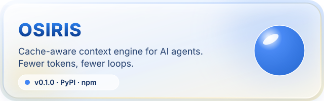
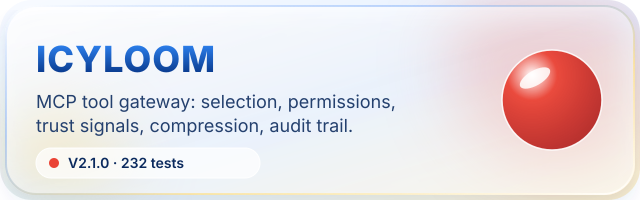
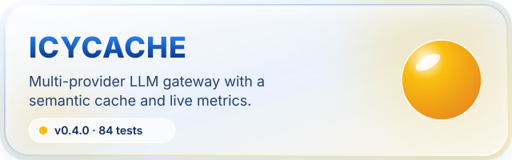
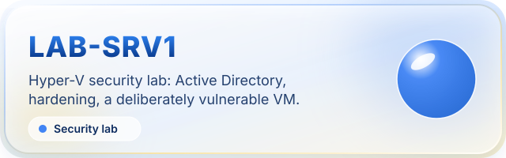
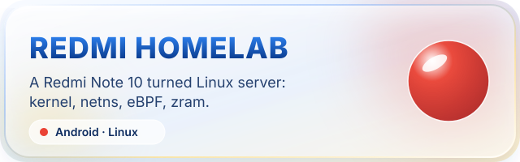

 

**IT student in Montréal · French / English** 
I build local-first AI infrastructure and security labs, and I document every result honestly.

  

 

    

 

---

## 🚀 What's new

| Date | Project | What shipped |
|---|---|---|
| **2026-11-04** | **[Osiris](https://github.com/MlkBlk-IT/osiris) 4-bug fix** | LoopGuard escalates (warn 3 / block 5, precheck denies), structured plan constraints enforced, handoff ref leak removed, honest unverified integrity, dashboard shows UNVERIFIED instead of a fake VIOLATION. 124 tests passed. [Commit](https://github.com/MlkBlk-IT/osiris/commit/50cef21) |
| **2026-11-04** | **[IcyLoom](https://github.com/MlkBlk-IT/icy-loom) V2.2.0** | Fail-closed relay: unknown tools are denied by default, `tool_simulate` now matches `invoke_tool`, `pwsh` is classified by the command, every server shows its real status (up/down/no-tools + last error), schema-drift noise purged (910 cosmetic entries), cache metrics really recorded, the catalogue reaches **102 server entries** (18 active, 84 dormant) with a pager and a real per-server Tester, and the console now shows a **live economy metric** re-queried from SQLite every second — summed over disjoint domains, so the headline and the registry card finally agree. [Changelog](https://github.com/MlkBlk-IT/icy-loom/blob/main/CHANGELOG.md) |
| **2026-11-04** | **[hermes-environment](https://github.com/MlkBlk-IT/hermes-environment) setup ops** | Versioned setup (redacted), weekly backup (Mon 03:00), 3 profiles + Kanban, 5-min liveness alert. Details: [docs/08](https://github.com/MlkBlk-IT/hermes-environment/blob/master/docs/08-setup-ops-2026-11-04.md) |
| **2026-11-04** | **[Loom (mcp-loom-mcp)](https://github.com/MlkBlk-IT/mcp-loom-mcp) dashboard v4** | Dashboard rewritten: brighter glass UI, simplified panels with side drawers, simple canvas charts, new **Quickstart / How-to / Help** docs in English. Fixed a dashboard-killing JS syntax error and SSE CORS headers. See [PROGRESS.md §12](https://github.com/MlkBlk-IT/mcp-loom-mcp/blob/main/PROGRESS.md) · [UPDATE-NOTES.md](https://github.com/MlkBlk-IT/mcp-loom-mcp/blob/main/UPDATE-NOTES.md) |
| **2026-11-04** | **[IcyLoom](https://github.com/MlkBlk-IT/icy-loom) V2.1.0** | Trust signals on the relay: MCP annotations are read (they can only escalate a side effect), a changed tool definition is journalised in `tool_drift`, a structured result is checked against its declared `outputSchema`, and a result carrying an injection is flagged instead of being served silently. Two new meta-tools, `tool_drift` and `tool_simulate`, and a new **Trust signals** panel in the console. [Release](https://github.com/MlkBlk-IT/icy-loom/releases/tag/v2.1.0) |
| **2026-11-03** | **[IcyCache](https://github.com/MlkBlk-IT/icycache) v0.4.0** | The semantic cache is now multilingual: 24 language profiles, no language hardcoded in the source, 84 tests. [Release](https://github.com/MlkBlk-IT/icycache/releases/tag/v0.4.0) |
| **2026-11-03** | **[IcyLoom](https://github.com/MlkBlk-IT/icy-loom) V2** | The MCP tool gateway: governed registry, plain-language tool selection, roles + approvals, compressed schemas, full audit trail. Released as v2.0.0. [Announcement](https://github.com/MlkBlk-IT/icy-loom/blob/main/ANNOUNCEMENT.md) |
| **2026-11-03** | **[Osiris](https://github.com/MlkBlk-IT/osiris)** | v0.1.1 released on GitHub (PyPI and npm still at 0.1.0). |

## 📊 By the numbers

| 🧰 Tools indexed | 🖥️ MCP servers | 🔌 MCP tools exposed | ✅ Tests (IcyLoom) | 🌍 Languages (IcyCache) |
|:---:|:---:|:---:|:---:|:---:|
| **222** | **16** | **21** | **248** | **24** |

IcyLoom V2 figures: **222 tools indexed across 16 servers** (18 active entries in `tool_proxy.servers`, 84 dormant in `tool_proxy.catalog`), **21 tools exposed** by the MCP server, **248 tests collected** — 245 passed, 3 skipped, 0 failed (suite re-run locally, exit 0). Osiris: **+71.48 %** net prompt savings at 20 000 tokens, 6 MCP tools.

## Latest releases

<!-- releases:start -->
- `2026-11-04` **[osiris](https://github.com/MlkBlk-IT/osiris/releases/tag/v0.1.1)** v0.1.1
- `2026-11-04` **[icy-loom](https://github.com/MlkBlk-IT/icy-loom/releases/tag/v2.1.0)** v2.1.0
- `2026-11-03` **[icycache](https://github.com/MlkBlk-IT/icycache/releases/tag/v0.4.0)** v0.4.0
- `2026-10-26` **[mcp-loom-mcp](https://github.com/MlkBlk-IT/mcp-loom-mcp/releases/tag/v0.1.3)** v0.1.3
<!-- releases:end -->

## What I do

| 🤖 AI infrastructure | 🛡️ Security and systems | 🎯 Where I'm heading |
|---|---|---|
| MCP servers, caching and context engineering, built to run on a CPU-only laptop and free-tier APIs. | Active Directory, firewall hardening and Hyper-V labs. Every change is documented and tested. | Security + AI + Cloud. Preparing industry certifications. |

## Featured

<table>
<tr>
<td width="50%"></td>
<td width="50%"></td>
</tr>
<tr>
<td width="50%"></td>
<td width="50%"></td>
</tr>
</table>

## Security and homelab

<table>
<tr>
<td width="50%"></td>
<td width="50%"></td>
</tr>
</table>

## More projects

- **[Loom](https://github.com/MlkBlk-IT/mcp-loom-mcp)**: portable MCP context server (SQLite + FTS5), early v0.1.x
- **[Mcp-QadGraph](https://github.com/MlkBlk-IT/Mcp-QadGraph)**: Qdrant 3D similarity dashboard + read-only MCP server
- **[LoFT](https://github.com/MlkBlk-IT/LoFT)**: CPU LoRA fine-tuning lab on Qwen3
- **[OpenClaw](https://github.com/MlkBlk-IT/OpenClaw)**: hybrid local + cloud AI architecture lab
- **[Smart RAM Booster](https://github.com/MlkBlk-IT/smart-ram-booster)**: Windows 11 RAM optimizer with a native engine

## Toolbox

        

## How I work

- Show what is verified, what is experimental and what is still unknown.
- Keep credentials and private configuration out of source control.
- Prefer local, reversible and low-cost solutions.
- Build small, measure, then document the result.

## Looking for

Internships, apprenticeships and practical open-source collaboration in Montréal. The fastest way to reach me is through the repositories above (issues and discussions are open).

 

Original projects and documentation by <strong>Malik Belkacemi · MLKBLK-IT</strong> · © 2026 · <a href="PROJECT-ORIGIN.md">Project origin</a> · <a href="LICENSE">License</a>

