

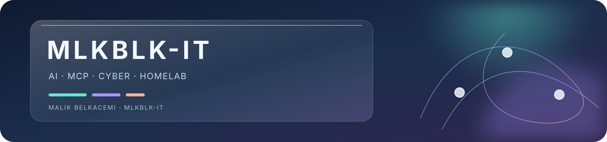

<h1>Malik Belkacemi</h1>

<strong>AI builder · IT support · cybersecurity · local systems</strong>

Montreal, Quebec · French / English · self-taught by building, testing and documenting.

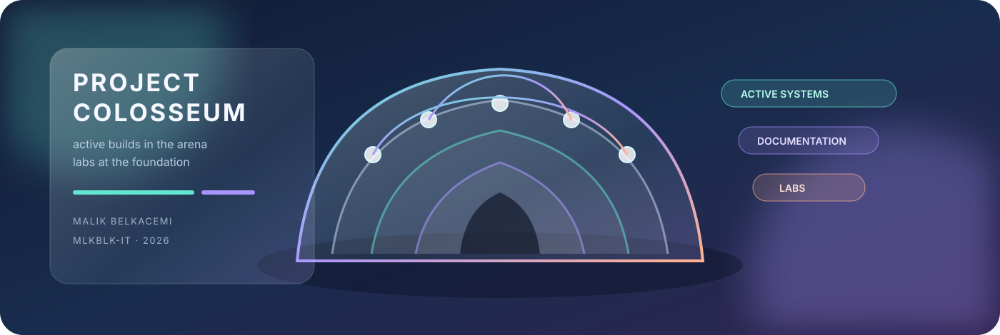

## The active arena

These are the projects I am actively building, testing or improving now.

<a href="https://github.com/MlkBlk-IT/ViaRoma">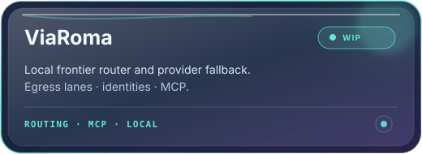</a>
<a href="https://github.com/MlkBlk-IT/icycache">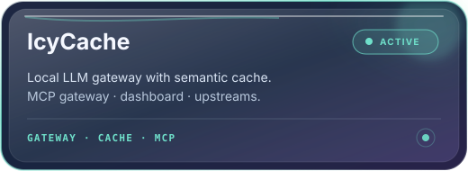</a>

<a href="https://github.com/MlkBlk-IT/icy-loom">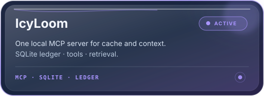</a>
<a href="https://github.com/MlkBlk-IT/mcp-loom-mcp">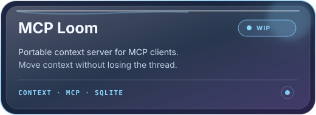</a>

<a href="https://github.com/MlkBlk-IT/Mcp-QadGraph">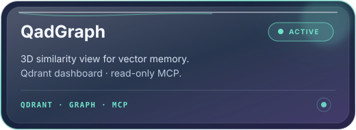</a>

<a href="https://github.com/MlkBlk-IT/LoFT">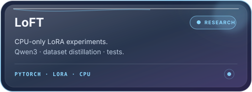</a>

### Also active

- [FocusDopa for Android](https://github.com/MlkBlk-IT/FocusDopa-Android) — a focus assistant and reminders project for Android Studio.
- [mcp-loom-mcp](https://github.com/MlkBlk-IT/mcp-loom-mcp) — context tooling measured honestly, with demo and production states kept distinct.

## What I build

- Local AI, MCP servers and provider tooling that stay understandable.
- CPU-first experiments that work within real hardware limits.
- Windows, Linux and Android infrastructure.
- Security labs where every change and result is documented.

## The lab foundation

These projects are intentionally placed at the end: they are important reference work, but they are not the centre of the active project stream.

<a href="https://github.com/MlkBlk-IT/Redmi-Note-10-HomeLab">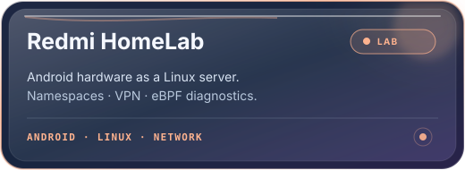</a>
<a href="https://github.com/MlkBlk-IT/Lab-SRV1">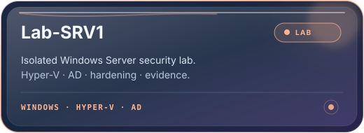</a>
<a href="https://github.com/MlkBlk-IT/OpenClaw">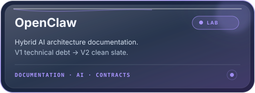</a>

- [Redmi Note 10 HomeLab](https://github.com/MlkBlk-IT/Redmi-Note-10-HomeLab) — Android hardware, Linux, namespaces, VPN and eBPF.
- [Lab-SRV1](https://github.com/MlkBlk-IT/Lab-SRV1) — an isolated Hyper-V and Windows Server cybersecurity lab.
- [OpenClaw](https://github.com/MlkBlk-IT/OpenClaw) — documentation of a hybrid AI architecture reset, not an active product.

## My working principles

- Show what is verified, what is experimental and what is still unknown.
- Keep credentials and private configuration outside source control.
- Prefer local, reversible and low-cost solutions.
- Build small, measure them, then document the result.

## Looking for

Internships, apprenticeships and practical open-source collaboration in Montreal.

  
Built and documented by <strong>Malik Belkacemi · MlkBlk-IT</strong>.

## Ownership and license

[Project origin and evidence](PROJECT-ORIGIN.md) · [License](LICENSE)

---

Original project and documentation by <strong>Malik Belkacemi · MLKBLK-IT</strong> · © 2026

