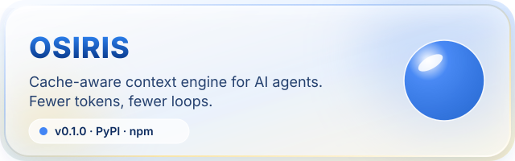
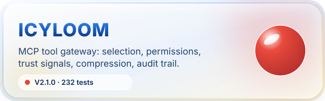
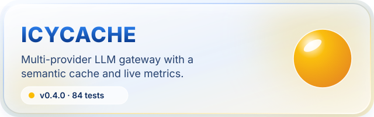
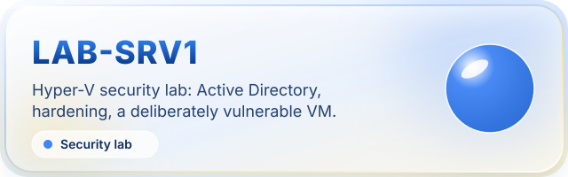
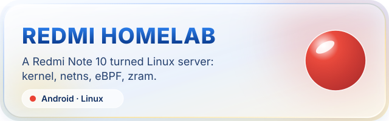

 

**IT student in Montréal · French / English** 
I build local-first AI infrastructure and security labs, and I document every result honestly.

  

 

    

 

---

## 🚀 What's new

> ### 🆕 KYRX — coming this Friday
> **A content-addressed coordination plane for LLM agent fleets.** Agents exchange *handles* (content addresses), not prose — state is computed by deterministic reducers, and a model is called only on steps explicitly flagged as ambiguous.
> *Compute where it is deterministic, infer where it is ambiguous.*
> MCP server · CPU-first · measured: **9/9 bench criteria**, **107 tests**, strict `mypy`, **96.1 %** token saving vs a naive fleet, p95 claim latency **0.62 ms**.
> **Public repo landing this Friday.**

| Date | Project | What shipped |
|---|---|---|
| **2026-11-06** | **[Osiris](https://github.com/MlkBlk-IT/osiris) v0.1.2** | Release hardening: npm OIDC publication fixed and verified before publish, dashboard refuses non-loopback binds without a token, SQLite migrations versioned (`PRAGMA user_version`) and transactional, CI matrix Windows + Linux × Python 3.12/3.13, wheel tested after a clean install. **146 tests.** [Release](https://github.com/MlkBlk-IT/osiris/releases/tag/v0.1.2) |
| **2026-11-06** | **[IcyLoom](https://github.com/MlkBlk-IT/icy-loom) V2.2.2 — on PyPI and npm** | Distribution release: wheel and sdist published on **PyPI** (trusted publishing, no stored token) and the CLI on **npm** with provenance. `pip install icyloom` · `npm install -g icyloom`. **248 passed, 3 skipped, 0 failed.** [Release](https://github.com/MlkBlk-IT/icy-loom/releases/tag/v2.2.2) |
| **2026-11-04** | **[IcyLoom](https://github.com/MlkBlk-IT/icy-loom) V2.2.0** | Fail-closed relay: unknown tools denied by default, real per-server status, schema-drift noise purged, catalogue reaches **102 server entries**, live economy metric re-queried from SQLite every second. [Changelog](https://github.com/MlkBlk-IT/icy-loom/blob/main/CHANGELOG.md) |

## 📊 By the numbers

| 🧰 Tools indexed | 🖥️ MCP servers | 🔌 MCP tools exposed | ✅ Tests (IcyLoom) | 🌍 Languages (IcyCache) |
|:---:|:---:|:---:|:---:|:---:|
| **222** | **16** | **21** | **251** | **24** |

IcyLoom V2 figures: **222 tools indexed across 16 servers** (18 active entries in `tool_proxy.servers`, 84 dormant in `tool_proxy.catalog`), **21 tools exposed** by the MCP server, **251 tests collected** — 248 passed, 3 skipped, 0 failed (suite re-run locally, exit 0). Since V2.2.2 IcyLoom ships on **PyPI** (`pip install icyloom`) and **npm** (`npm install -g icyloom`, published with provenance) — both channels publish on every release. Osiris: **+71.48 %** net prompt savings at 20 000 tokens, 6 MCP tools — 146 tests.

## Latest releases

<!-- releases:start -->
- `2026-11-06` **[osiris](https://github.com/MlkBlk-IT/osiris/releases/tag/v0.1.2)** v0.1.2
- `2026-11-06` **[icy-loom](https://github.com/MlkBlk-IT/icy-loom/releases/tag/v2.2.2)** v2.2.2
- `2026-11-03` **[icycache](https://github.com/MlkBlk-IT/icycache/releases/tag/v0.4.0)** v0.4.0
- `2026-10-26` **[mcp-loom-mcp](https://github.com/MlkBlk-IT/mcp-loom-mcp/releases/tag/v0.1.3)** v0.1.3
<!-- releases:end -->

## What I do

| 🤖 AI infrastructure | 🛡️ Security and systems | 🎯 Where I'm heading |
|---|---|---|
| MCP servers, caching and context engineering, built to run on a CPU-only laptop and free-tier APIs. | Active Directory, firewall hardening and Hyper-V labs. Every change is documented and tested. | Security + AI + Cloud. Preparing industry certifications. |

## Featured

<table>
<tr>
<td width="50%"></td>
<td width="50%"></td>
</tr>
<tr>
<td width="50%"></td>
<td width="50%"></td>
</tr>
</table>

## Security and homelab

<table>
<tr>
<td width="50%"></td>
<td width="50%"></td>
</tr>
</table>

## More projects

- **[Loom](https://github.com/MlkBlk-IT/mcp-loom-mcp)**: portable MCP context server (SQLite + FTS5), early v0.1.x
- **[Mcp-QadGraph](https://github.com/MlkBlk-IT/Mcp-QadGraph)**: Qdrant 3D similarity dashboard + read-only MCP server
- **[LoFT](https://github.com/MlkBlk-IT/LoFT)**: CPU LoRA fine-tuning lab on Qwen3
- **[OpenClaw](https://github.com/MlkBlk-IT/OpenClaw)**: hybrid local + cloud AI architecture lab
- **[Smart RAM Booster](https://github.com/MlkBlk-IT/smart-ram-booster)**: Windows 11 RAM optimizer with a native engine

## Toolbox

        

## How I work

- Show what is verified, what is experimental and what is still unknown.
- Keep credentials and private configuration out of source control.
- Prefer local, reversible and low-cost solutions.
- Build small, measure, then document the result.

## Looking for

Internships, apprenticeships and practical open-source collaboration in Montréal. The fastest way to reach me is through the repositories above (issues and discussions are open).

 

Original projects and documentation by <strong>Malik Belkacemi · MLKBLK-IT</strong> · © 2026 · <a href="PROJECT-ORIGIN.md">Project origin</a> · <a href="LICENSE">License</a>

