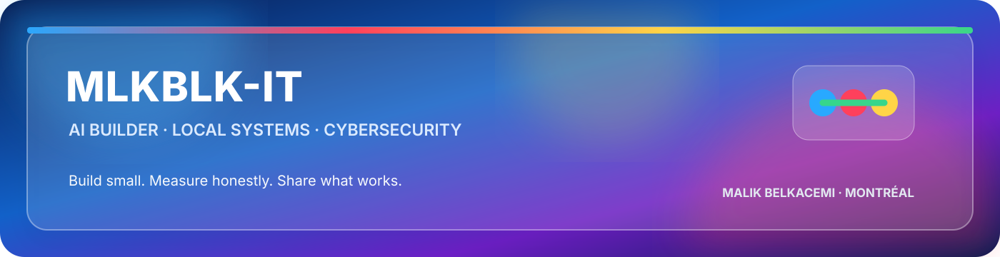
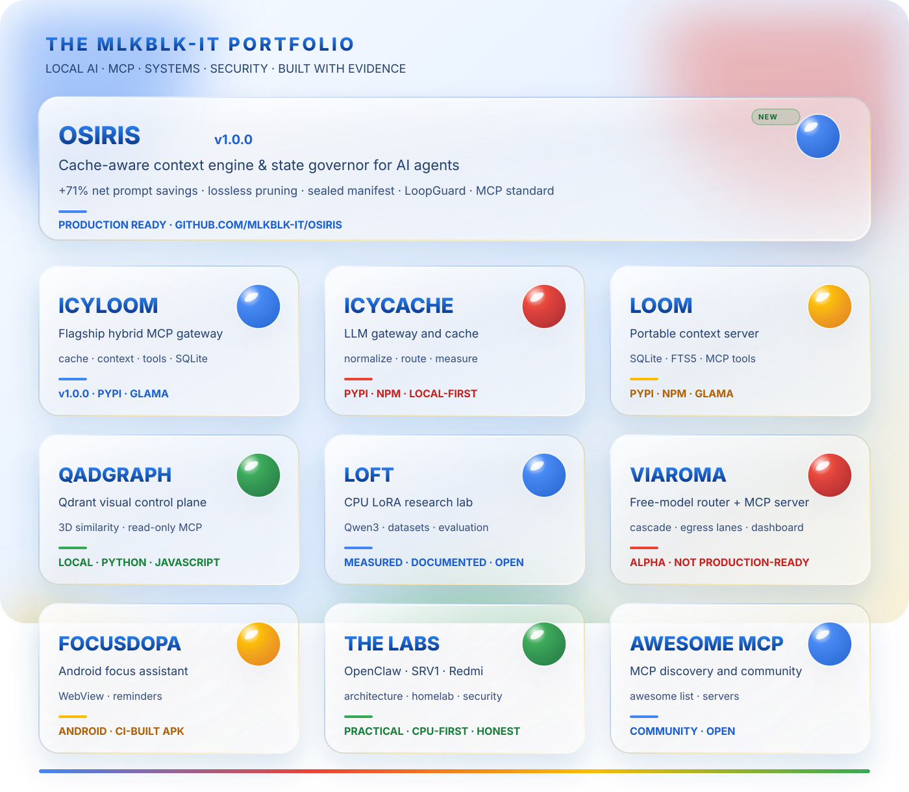
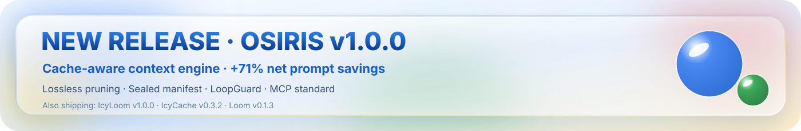
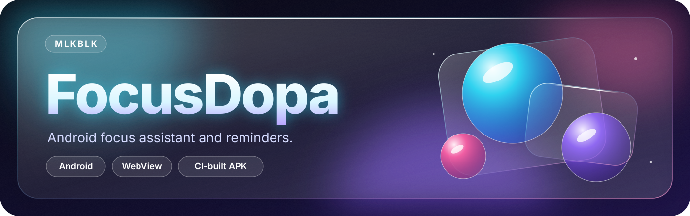

<h1>MLKBLK</h1>

<strong>AI builder · IT support · cybersecurity · local + cloud systems</strong>

Montreal, Quebec · French / English · self-taught by building, testing and documenting.

## NEW RELEASE

**[OSIRIS v1.0.0](https://github.com/MlkBlk-IT/osiris)** · **[IcyLoom v1.0.0](https://github.com/MlkBlk-IT/icy-loom/releases/tag/v1.0.0)** · **[IcyCache v0.3.2](https://github.com/MlkBlk-IT/icycache/releases)** · **[Loom v0.1.3](https://github.com/MlkBlk-IT/mcp-loom-mcp/releases)**

PyPI + npm + GitHub releases · MCP-ready · CPU-first · local, cloud and hybrid workflows.

| Project | GitHub | Description | Status |
|---|---|---|---|
| OSIRIS | [repo](https://github.com/MlkBlk-IT/osiris) | Cache-aware context engine & state governor (+71% net prompt savings) | Production ready |
| IcyLoom | [release](https://github.com/MlkBlk-IT/icy-loom/releases/tag/v1.0.0) | Hybrid MCP gateway: cache, context drawer, tool relay | v1.0.0 |
| IcyCache | [releases](https://github.com/MlkBlk-IT/icycache/releases) | Multi-provider gateway and cache | v0.3.2 |
| Loom | [releases](https://github.com/MlkBlk-IT/mcp-loom-mcp/releases) | Portable context layer for hybrid MCP workflows | v0.1.3 |

## MCP / AI PRODUCTS

<table><tr><td width="50%" valign="top"> <b><a href="https://github.com/MlkBlk-IT/osiris">OSIRIS</a></b> Cache-aware context engine, lossless pruning and prefix integrity.</td><td width="50%" valign="top"> <b><a href="https://github.com/MlkBlk-IT/icy-loom">IcyLoom</a></b> Hybrid MCP gateway for local and cloud workflows.</td></tr><tr><td width="50%" valign="top"> <b><a href="https://github.com/MlkBlk-IT/icycache">IcyCache</a></b> Multi-provider gateway and cache.</td><td width="50%" valign="top"> <b><a href="https://github.com/MlkBlk-IT/mcp-loom-mcp">Loom</a></b> Portable context layer for hybrid MCP workflows.</td></tr><tr><td width="50%" valign="top"> <b><a href="https://github.com/MlkBlk-IT/Mcp-QadGraph">Mcp-QadGraph</a></b> Qdrant control plane and read-only MCP.</td><td width="50%" valign="top"> <b><a href="https://github.com/MlkBlk-IT/ViaRoma">ViaRoma</a></b> · <i>alpha</i> Free-model router and MCP server. Not production-ready.</td></tr></table>

## DOC / RESEARCH / COMMUNITY

<table><tr><td width="50%" valign="top"> <b><a href="https://github.com/MlkBlk-IT/LoFT">LoFT</a></b> CPU LoRA and Qwen3 research.</td><td width="50%" valign="top"> <b><a href="https://github.com/MlkBlk-IT/OpenClaw">OpenClaw</a></b> Hybrid AI architecture lab.</td></tr><tr><td width="50%" valign="top"> <b><a href="https://github.com/MlkBlk-IT/awesome-mcp-servers">Awesome MCP Servers</a></b> MCP discovery and community.</td><td width="50%"></td></tr></table>

## What I build

- Local, cloud and hybrid AI infrastructure that stays understandable.
- CPU-first experiments and cloud integrations that work within real hardware limits.
- Windows, Linux and Android infrastructure.
- Security labs where every change and result is documented.

## LAB / INFRASTRUCTURE

<table><tr><td width="50%" valign="top"> <b><a href="https://github.com/MlkBlk-IT/Lab-SRV1">Lab-SRV1</a></b> Hyper-V and Windows Server security lab.</td><td width="50%" valign="top"> <b><a href="https://github.com/MlkBlk-IT/Redmi-Note-10-HomeLab">Redmi HomeLab</a></b> Android, Linux, eBPF and networking.</td></tr><tr><td width="50%" valign="top"> <b><a href="https://github.com/MlkBlk-IT/FocusDopa-Android">FocusDopa</a></b> Android focus assistant and reminders.</td><td width="50%"></td></tr></table>

## My working principles

- Show what is verified, what is experimental and what is still unknown.
- Keep credentials and private configuration outside source control.
- Prefer local, reversible and low-cost solutions.
- Build small, measure them, then document the result.

## Looking for

Internships, apprenticeships and practical open-source collaboration in Montreal.

  
Built and documented by <strong>MLKBLK-IT</strong>.

## Ownership and license

[Project origin and evidence](PROJECT-ORIGIN.md) · [License](LICENSE)

---

Original project and documentation by <strong>Malik Belkacemi · MLKBLK-IT</strong> · © 2026

