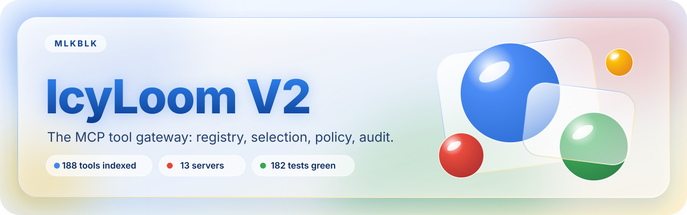
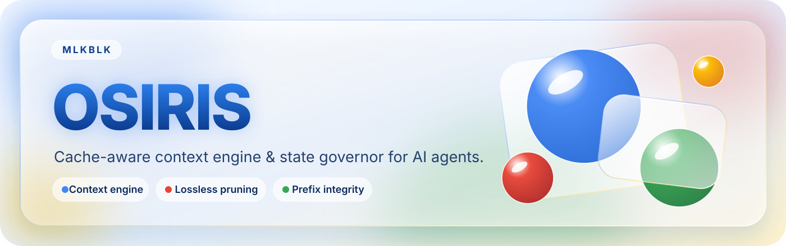
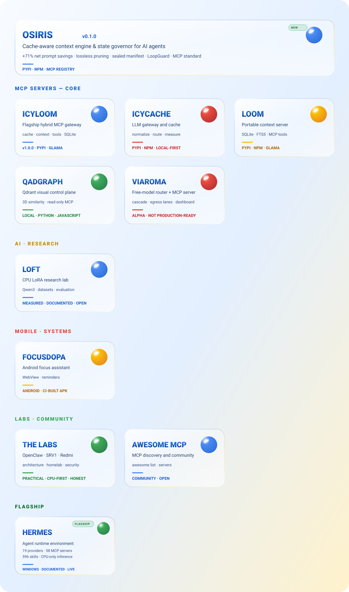
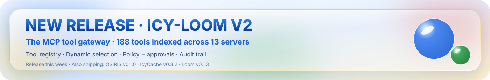

<h1>MLKBLK</h1>

<strong>AI builder · IT support · cybersecurity · local + cloud systems</strong>

Montreal, Quebec · French / English · self-taught by building, testing and documenting.



---

## 🚀 ANNOUNCEMENT — IcyLoom V2 ships this week

**One MCP server. One SQLite file. One ledger that tells you what it actually saved — and now a governed registry in front of every tool.**

| **188** tools indexed | **13** servers | **19** MCP tools | **186** tests | **+71.48 %** net savings | **0** embeddings |
|---|---|---|---|---|---|

**ICY-LOOM V2 — the MCP tool gateway.** Every tool catalogued (schema, intent, side effects, scope, risk), the right one selected from a plain-language request, permissions enforced, context compressed, every decision logged. The tagged release ships **this week**.

→ [Read the V2 announcement](https://github.com/MlkBlk-IT/icy-loom/blob/main/ANNOUNCEMENT.md) · [repo](https://github.com/MlkBlk-IT/icy-loom) · [release notes](https://github.com/MlkBlk-IT/icy-loom/releases)

---

## HERO · ICY-LOOM V2

**The MCP tool gateway.** One MCP server, one SQLite file, one ledger — with a governed registry in front of every tool. A client that can *see* a tool no longer gets to *use* it.

| Metric | Measured |
|---|---|
| Tools indexed | **188** |
| Servers behind the gateway | **13** |
| MCP tools exposed | **19** — 13 from V1 + 6 meta-tools |
| Read-only share | **69.1 %** — 130 tools |
| Writes / destructive | 43 (22.9 %) / 15 (8.0 %) — destructive needs an explicit approval |
| Decisions traced | **58** — 40 allowed · 17 approvals · 1 refused (outside project scope) |
| Tokens saved by compression | **386 383** — 30 093 on a single `read_file` |
| Tokens measured (7 days) | **577 064** |
| Selection | lexical FTS5/BM25, **12 languages**, **no embeddings** |
| Test suite | **186 passing** |
| Load pass | **40** real calls through the gateway - 0 error, **30** served from the local cache |
| Hit rate under load | **75.6 %** - 102 hits / 28 misses, **254 536** tokens avoided, gain **92.1 %** |

<table>
<tr><td width="50%" valign="top">
<b>What V2 adds</b>  
• Tool registry: schema, intent, side effects, scope, risk 
• Dynamic selection from a natural-language request 
• Roles <code>reader</code> / <code>writer</code> / <code>operator</code> / <code>admin</code> + approvals 
• Schema &amp; result compression, prompt-cache safe 
• Sandboxed script runner 
• Decision audit trail + tokens-per-category metering
</td><td width="50%" valign="top">
<b>Install</b>  
<code>pip install -e .</code> 
<code>python -m icyloom mcp --transport stdio</code>  
<b>Release</b>  
v2.0.0 — <b>this week</b> 
MIT · Python 3.11 → 3.13 · 127.0.0.1 only
</td></tr>
</table>

---

## HERO · OSIRIS

**The cache-aware context engine & state governor for AI agents.** Fewer tokens, fewer loops, zero unnecessary tools, zero loss of context.

| Metric | Measured |
|---|---|
| Net prompt savings at 20 000 tokens | **+71.48 %** |
| Net savings at 5 000 / 2 000 tokens | **+61.09 %** / **+41.99 %** |
| Session Net Gate | **PASS** — worst case +972 tokens |
| MCP tools | **6** — ~1 019 tokens of schema |
| Test suite | **77 passing** |
| Distribution | PyPI · npm · MCP Registry |

<table>
<tr><td width="50%" valign="top">
<b>Core</b>  
• Sealed manifest carried by the agent (~120 tokens) 
• Prefix-stable hashing — the prompt cache holds 
• Invariants TOML rule engine (guard rails) 
• Tool Compass — dynamic relevance scoring 
• Executable handoff contracts
</td><td width="50%" valign="top">
<b>Install</b>  
<code>pip install mcp-osiris</code> 
<code>npm i osiris-mcp</code>  
<b>Release</b>  
v0.1.0 · MIT · Python 3.12+ 
Local-first · independent of any model provider
</td></tr>
</table>

---

## NEW RELEASE

**[OSIRIS v0.1.0](https://github.com/MlkBlk-IT/osiris)** · **[IcyLoom v2.0.0](https://github.com/MlkBlk-IT/icy-loom/releases)** — ships this week · **[IcyCache v0.3.2](https://github.com/MlkBlk-IT/icycache/releases)** · **[Loom v0.1.3](https://github.com/MlkBlk-IT/mcp-loom-mcp/releases)**

PyPI + npm + GitHub releases · MCP-ready · CPU-first · local, cloud and hybrid workflows.

| Project | GitHub | Description | Status |
|---|---|---|---|
| OSIRIS | [repo](https://github.com/MlkBlk-IT/osiris) | Cache-aware context engine & state governor (+71% net prompt savings) | v0.1.0 · PyPI · npm · MCP Registry |
| IcyLoom | [repo](https://github.com/MlkBlk-IT/icy-loom) | MCP tool gateway: registry, dynamic selection, policy, compression, audit | **v2.0.0 — this week** |
| IcyCache | [releases](https://github.com/MlkBlk-IT/icycache/releases) | Multi-provider gateway and cache | v0.3.2 |
| Loom | [releases](https://github.com/MlkBlk-IT/mcp-loom-mcp/releases) | Portable context layer for hybrid MCP workflows | v0.1.3 |

## FLAGSHIP: HERMES ENVIRONMENT

**[HERMES environment](https://github.com/MlkBlk-IT/hermes-environment)** is the runtime this whole portfolio runs on: a Windows host orchestrating 19 LLM providers, 58 MCP servers, 596 loaded skills, 26 plugins and 7 cron jobs — CPU-only, free-tier, fully documented from the live installation.

| Layer | What it does |
|---|---|
| Providers + routing | 19 providers with combo/fallback and cache-aware routing |
| MCP fleet | 58 declared MCP servers, gateway-mediated |
| Context | Loom / IcyLoom context drawer + Osiris state governor |
| Vectors | Qdrant 2560-dim (qwen3-embedding, CPU) |
| Inference | LM Studio as last resort, 0 VRAM |

Every project below is built, tested and documented on this environment.

## MCP / AI PRODUCTS

<table><tr><td width="50%" valign="top"> <b><a href="https://github.com/MlkBlk-IT/osiris">OSIRIS</a></b> Cache-aware context engine, lossless pruning and prefix integrity.</td><td width="50%" valign="top"> <b><a href="https://github.com/MlkBlk-IT/icy-loom">IcyLoom</a></b> Hybrid MCP gateway for local and cloud workflows.</td></tr><tr><td width="50%" valign="top"> <b><a href="https://github.com/MlkBlk-IT/icycache">IcyCache</a></b> Multi-provider gateway and cache.</td><td width="50%" valign="top"> <b><a href="https://github.com/MlkBlk-IT/mcp-loom-mcp">Loom</a></b> Portable context layer for hybrid MCP workflows.</td></tr><tr><td width="50%" valign="top"> <b><a href="https://github.com/MlkBlk-IT/Mcp-QadGraph">Mcp-QadGraph</a></b> Qdrant control plane and read-only MCP.</td><td width="50%" valign="top"> <b><a href="https://github.com/MlkBlk-IT/ViaRoma">ViaRoma</a></b> · <i>alpha</i> Free-model router and MCP server. Not production-ready.</td></tr></table>

## DOC / RESEARCH / COMMUNITY

<table><tr><td width="50%" valign="top"> <b><a href="https://github.com/MlkBlk-IT/LoFT">LoFT</a></b> CPU LoRA and Qwen3 research.</td><td width="50%" valign="top"> <b><a href="https://github.com/MlkBlk-IT/OpenClaw">OpenClaw</a></b> Hybrid AI architecture lab.</td></tr><tr><td width="50%" valign="top"> <b><a href="https://github.com/MlkBlk-IT/awesome-mcp-servers">Awesome MCP Servers</a></b> MCP discovery and community.</td><td width="50%"></td></tr></table>

## What I build

- Local, cloud and hybrid AI infrastructure that stays understandable.
- CPU-first experiments and cloud integrations that work within real hardware limits.
- Windows, Linux and Android infrastructure.
- Security labs where every change and result is documented.

## LAB / INFRASTRUCTURE

<table><tr><td width="50%" valign="top"> <b><a href="https://github.com/MlkBlk-IT/Lab-SRV1">Lab-SRV1</a></b> Hyper-V and Windows Server security lab.</td><td width="50%" valign="top"> <b><a href="https://github.com/MlkBlk-IT/Redmi-Note-10-HomeLab">Redmi HomeLab</a></b> Android, Linux, eBPF and networking.</td></tr><tr><td width="50%" valign="top"> <b><a href="https://github.com/MlkBlk-IT/FocusDopa-Android">FocusDopa</a></b> Android focus assistant and reminders.</td><td width="50%"> <b><a href="https://github.com/MlkBlk-IT/smart-ram-booster">Smart RAM Booster</a></b> Windows 11 RAM optimizer: native engine, real measurements.</td></tr></table>

## My working principles

- Show what is verified, what is experimental and what is still unknown.
- Keep credentials and private configuration outside source control.
- Prefer local, reversible and low-cost solutions.
- Build small, measure them, then document the result.

## Looking for

Internships, apprenticeships and practical open-source collaboration in Montreal.

  
Built and documented by <strong>MLKBLK-IT</strong>.

## Ownership and license

[Project origin and evidence](PROJECT-ORIGIN.md) · [License](LICENSE)

---

Original project and documentation by <strong>Malik Belkacemi · MLKBLK-IT</strong> · © 2026

